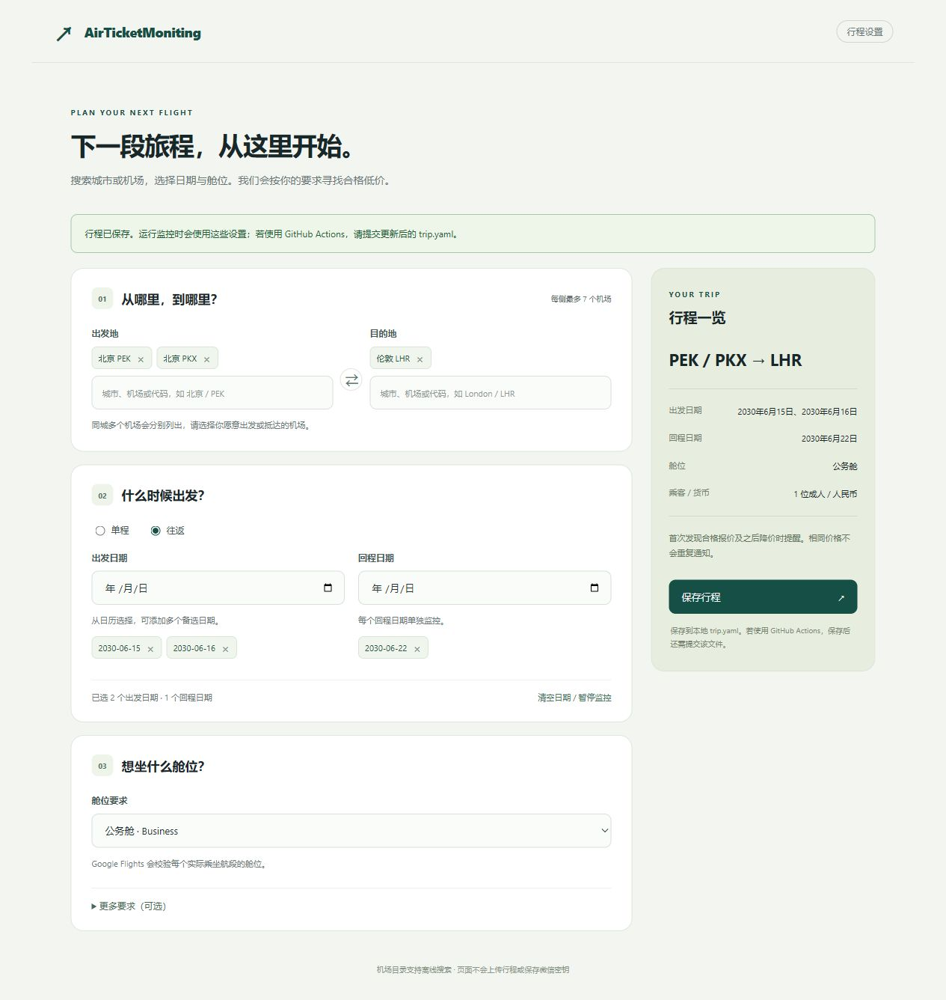

# AirTicketMoniting

[](https://github.com/JunchengLiu-RICE/AirTicketMoniting/actions/workflows/test.yml)
[](LICENSE)

Monitor flight prices by choosing airports, departure dates and a cabin. Google Flights finds the lowest qualifying fare, and optional ServerChan notifications reach WeChat when the first fare is found and whenever a later fare is lower.

The template starts with **no active dates and no notification key**. The airports and future dates shown below are examples, not an active monitoring task.

## Choose how to use it

| What you want | Start here | What you need |
|---|---|---|
| Run automatically without leaving a computer on | [GitHub Actions setup](#1-create-your-own-repository) | A GitHub account; edit the YAML file in your browser |
| Select cities and dates in a visual form | [Local installation](#3-install-locally-for-the-visual-editor), then [use the editor](#4-fill-in-the-visual-editor) | Python 3.12 or 3.13 on your computer |
| Run checks entirely on your own computer | [Local installation](#3-install-locally-for-the-visual-editor), then [run locally](#6-run-the-monitor-locally) | Keep the monitor process and computer running |

The visual editor runs on your computer. GitHub does not host that editor as a website. You can still configure and run Actions entirely in the GitHub browser interface by editing `trip.yaml`.

## 1. Create your own repository

1. Sign in to GitHub and open [the AirTicketMoniting template](https://github.com/JunchengLiu-RICE/AirTicketMoniting).
2. Above the file list, select **Use this template → Create a new repository**.
3. Set **Owner** to your own account.
4. Choose a repository name, for example `my-flight-monitor`.
5. Choose **Private** for personal travel monitoring. Leave **Include all branches** unchecked if that option appears.
6. Click **Create repository** or **Create repository from template**.
7. Wait for the files to appear. Keep the default branch named **`main`**.

**Expected result:** you have your own repository, with a `trip.yaml` file and an **Actions** tab. Make all subsequent changes in this new repository, rather than in the shared public template.

In a public repository, trip settings, Actions logs, report artifacts and the `monitor-state` branch are public. A private copy keeps these behind your repository access controls. The project does not publish GitHub Pages.

GitHub's [template-repository instructions](https://docs.github.com/en/repositories/creating-and-managing-repositories/creating-a-repository-from-a-template) describe this creation flow.

## 2. Configure and run directly on GitHub

Use this path if you do not want to install Python or use a terminal. For city search and calendar controls, use the local editor in sections 3–5 instead.

### 2.1 Add WeChat notifications, if wanted

You can skip this step and still query fares and view reports.

1. Open [ServerChan](https://sct.ftqq.com/), sign in, and obtain your **SendKey**. Follow the provider's instructions to connect your WeChat notification channel.
2. Return to **your own repository** on GitHub.
3. Open **Settings → Secrets and variables → Actions**.
4. On the **Secrets** tab, click **New repository secret**.
5. Enter **`SERVERCHAN_KEY`** in **Name**, using that exact spelling.
6. Paste your SendKey into **Secret**, then click **Add secret**.

**Expected result:** `SERVERCHAN_KEY` appears in the repository's secret-name list. Its value is not displayed again. Do not put the value into `trip.yaml`, a commit, an issue, or a screenshot.

Secrets are not copied from the template or from another repository. Each monitoring repository needs its own configuration. See GitHub's [repository-secret instructions](https://docs.github.com/en/actions/how-tos/write-workflows/choose-what-workflows-do/use-secrets).

### 2.2 Edit the trip file

1. Open **Code → `trip.yaml`** in your own repository.
2. Click the **pencil / Edit this file** button.
3. Replace the example settings with your airports, future dates and cabin. A minimal file looks like this:

```yaml
origin: JFK
destination: LHR
dates: ["2030-06-15", "2030-06-16"]
cabin: economy
```

4. Keep dates in `YYYY-MM-DD` form and surround them with quotes. Use normal spaces for indentation, not tabs.
5. Click **Commit changes**. Enter a message such as `Update trip`, choose a direct commit to **`main`**, and confirm.

**Expected result:** reopening `trip.yaml` shows your changes on GitHub. Committing this file to `main` automatically requests a monitoring run.

Use actual airport codes, such as `PEK` or `PKX` for Beijing's different airports. The editor in section 4 helps you choose the correct airport without memorizing codes. See [configuration examples](#8-configuration-examples) for cabin choices, multiple airports and optional filters.

### 2.3 Start or inspect a run

1. Open the repository's **Actions** tab. Enable workflows if GitHub asks you to do so.
2. Select **AirTicketMoniting** in the workflow list on the left. **Tests** is a separate workflow; it does not query flights.
3. If a run already started from your configuration commit, open it and wait for completion.
4. To request another check, click **Run workflow**, choose branch **`main`**, then click the confirmation **Run workflow** button.
5. Wait for the new run to appear and open it. The run may first be queued before it starts.

There are no itinerary fields in the **Run workflow** dialog: the workflow reads the committed `trip.yaml` on `main`. If **Run workflow** is absent, first select the **AirTicketMoniting** workflow rather than the Actions overview. See GitHub's [manual workflow instructions](https://docs.github.com/en/actions/how-tos/manage-workflow-runs/manually-run-a-workflow).

**Expected result:** the run reaches a green completion status. This means the workflow completed; it does not necessarily mean that a qualifying fare was available or that an alert was required.

### 2.4 View the result and download the report

1. Open the completed **AirTicketMoniting** run.
2. Read its **Summary** for the latest qualifying quotes or a no-results message.
3. In the run's **Artifacts** area, download **`flight-report`** if present. Sign in with an account that can access the repository.
4. Extract the downloaded ZIP file. Find **`report.html`** in the extracted files and open it in a browser; do not open it while it is still inside the ZIP.
5. The archive also includes `latest.json` and `monitor.log` when generated. Use the log to investigate a failed query or a skipped notification.

Reports contain indicative fares in **CNY**. Each airport's departure and arrival times are local to that airport; an arrival time can be on a later day. Check the flight details with the booking provider before buying.

If `dates` is empty or all configured dates are expired, the workflow skips flight searches and creates no new price-report artifact. Report artifacts are retained for **7 days**. Saved history and the notification baseline remain on the separate `monitor-state` branch.

## 3. Install locally for the visual editor

Skip this section if you use only the GitHub browser workflow above.

First create your own repository as in section 1. Clone or download **that repository** so you can later send your configuration back to the correct destination.

### 3.1 Get the project files

Choose one method:

- **GitHub Desktop:** open your repository, choose **Code → Open with GitHub Desktop**, and select a local folder. This also provides a graphical way to commit and push later.
- **Git command line:** install Git if needed, then run the following commands. Replace `YOUR_ACCOUNT` and `my-flight-monitor` with your own account and repository name.

```bash
git clone https://github.com/YOUR_ACCOUNT/my-flight-monitor.git
cd my-flight-monitor
```

- **ZIP download:** choose **Code → Download ZIP** and extract it. This works for local-only monitoring, but the extracted folder has no Git history. To use Actions afterward, upload the updated `trip.yaml` to your repository through the GitHub browser editor, or use a proper clone.

**Expected result:** your project folder contains `README.md`, `requirements.txt`, `configure.py` and `trip.yaml`. Open your terminal in this folder before running the commands below.

### 3.2 Windows installation

Install **Python 3.12 or 3.13** from [python.org](https://www.python.org/downloads/). Then open PowerShell in the project folder. The following commands use Python 3.12; substitute `-3.13` if that is the version you installed.

```powershell
py -3.12 --version
py -3.12 -m venv .venv
.\.venv\Scripts\python.exe -m pip install --upgrade pip
.\.venv\Scripts\python.exe -m pip install -r requirements.txt
```

The first command should print a Python 3.12 version. Wait for the package installation to finish without an error. These commands use the virtual environment directly, so you do **not** need to activate a PowerShell script or change its execution policy.

Now double-click **`configure.cmd`** in the project folder, or run:

```powershell
.\.venv\Scripts\python.exe configure.py
```

**Expected result:** a terminal displays a local address such as `http://127.0.0.1:12345`, and your browser opens the trip editor. Your actual port will vary. If it does not open automatically, copy the exact address printed in the terminal into a browser.

### 3.3 macOS or Linux installation

Install Python 3.12 or 3.13, open a terminal in the project folder, and run:

```bash
python3 --version
python3 -m venv .venv
source .venv/bin/activate
python -m pip install --upgrade pip
python -m pip install -r requirements.txt
python configure.py
```

Check that the first command reports a supported Python version. If you have several versions, replace `python3` in the first two commands with the appropriate executable, such as `python3.12`.

Keep the editor's terminal open while using the form. Press **Ctrl+C** in that terminal to stop the editor when finished. The local address works only while the editor is running; opening `ui/index.html` directly or viewing it on GitHub does not start the editor.

No Chromium installation is needed for the editor or for the default Google Flights search. The optional Ctrip crawler has a separate browser requirement described in section 8.

## 4. Fill in the visual editor



This screenshot uses example airports and dates. It does not activate those settings in the template.

### 4.1 Select the airports

1. In the first card, remove the existing example airport chips using their **×** buttons if you do not want those airports.
2. In **Origin**, type a city name, airport name, IATA code, or common Chinese name. For example, searching `Beijing` displays the separate `PEK` and `PKX` airports.
3. Click the specific airport you want. It appears as a selected chip above the search box.
4. Repeat in **Destination**.
5. For alternatives, search and select additional airports on the same side. Each side supports up to **7** airports. Remove an alternative with its **×** button.
6. Use the **⇄** button between the two sides to swap the selected origin and destination airports.

Typing a city name alone does not select an airport. Choose a result before saving. For an unlisted airport, enter its exact three-letter IATA code and press **Enter**. You can also use the arrow keys and Enter to navigate search results.

### 4.2 Pick the dates

1. In the second card, choose **One-way** or **Return**.
2. Open the calendar control in **Departure date** and select a date. It becomes a date chip below the input.
3. To compare nearby days, choose additional dates. Previously selected dates remain selected; selecting the same date twice does not duplicate it.
4. For a return trip, select the return dates in the newly displayed field. Return dates must not be earlier than the earliest selected departure date.
5. Remove an unwanted date with its chip's **×** button.

The date input becomes empty after each selection so you can add another date. **The chips, date count and summary show the dates that are actually selected.**

The clear-dates control removes all selected dates. Saving that empty selection pauses searches. Switching from Return to One-way removes the selected return dates.

### 4.3 Choose the cabin and optional requirements

1. In the third card, select Economy, Premium Economy, Business or First.
2. If needed, expand **More requirements** below the cabin selector.
3. Set a departure-time cutoff, maximum number of connections, or airline codes. Leave these fields empty or unrestricted if you do not need them.
4. Review the route, selected dates and cabin in the summary card. On a narrow screen, the summary appears below the form.

The default Google Flights search verifies the selected cabin on **every flown segment**, including connections. An economy feeder segment will therefore exclude an itinerary when Business is selected. A departure-time cutoff is **strictly later than** the selected time at the departure airport; `18:00` does not include a departure at exactly 18:00. Optional filters apply to both directions of a return configuration.

### 4.4 Save and choose the next step

1. Click the green **Save trip** button.
2. Wait for the success message. Validation errors appear above the form; correct them and save again.
3. The form writes the settings to **`trip.yaml` in this project folder**. Existing optional settings are preserved unless you change their corresponding controls.
4. For GitHub Actions, continue to section 5. For local-only monitoring, continue to section 6.

**Saving does not start a search, send a WeChat message, commit a file or push anything to GitHub.** It only updates the local configuration. If another window changes the file, the editor stops the save and asks you to refresh, preventing an accidental overwrite.

## 5. Send the saved settings to GitHub Actions

This step is required after using the local editor if you want the cloud workflow to use your new settings.

### GitHub Desktop

1. Open your cloned monitoring repository in GitHub Desktop.
2. Review the changed **`trip.yaml`** under **Changes**.
3. Enter a commit summary such as `Update trip`, then click **Commit to main**.
4. Click **Push origin**.
5. Open the repository on GitHub and verify that `trip.yaml` contains the new settings. Then follow sections 2.3–2.4 to inspect the automatically triggered run.

### Git command line

From your cloned project folder, run:

```bash
git remote -v
git add trip.yaml
git commit -m "Update trip"
git push origin main
```

Before pushing, check that `git remote -v` points to **your monitoring repository**. Only `trip.yaml` needs to be committed for an itinerary change. If Git needs you to sign in, complete its normal GitHub authentication flow; do not use your SendKey as a GitHub password.

### If you downloaded a ZIP

Open the saved local `trip.yaml`, copy its complete contents, and paste them into your repository's **`trip.yaml` → Edit this file** page. Commit the update to `main` as in section 2.2.

## 6. Run the monitor locally

Use the same environment you installed in section 3. Close the editor with Ctrl+C first, or open another terminal in the same project folder.

### One check

Windows PowerShell:

```powershell
.\.venv\Scripts\python.exe main.py --once
```

macOS/Linux, with the virtual environment activated:

```bash
python main.py --once
```

**Expected result:** the terminal logs the query and either a qualifying lowest fare or a no-results message. Results are stored in `data/prices.db`; logs are stored in `logs/monitor.log`. This command does not generate an HTML report by itself.

### Continuous local monitoring

Run the same command without `--once`:

```powershell
# Windows
.\.venv\Scripts\python.exe main.py
```

```bash
# macOS/Linux, with the virtual environment activated
python main.py
```

The local scheduler runs an initial check and then repeats every **90 minutes**. Leave the terminal and computer running. Press **Ctrl+C** to stop. Restart the monitor after changing `trip.yaml`, because an already-running local process keeps the configuration it loaded at startup.

### Optional local WeChat notifications

GitHub repository secrets are not automatically available on your computer. Set the environment variable **`SERVERCHAN_KEY`** in the same terminal that will run the monitor.

Windows PowerShell, with a masked prompt:

```powershell
$sendKey = Read-Host "ServerChan SendKey" -AsSecureString
$env:SERVERCHAN_KEY = [System.Net.NetworkCredential]::new("", $sendKey).Password
.\.venv\Scripts\python.exe main.py --once
```

Bash, with a hidden prompt:

```bash
read -r -s -p "ServerChan SendKey: " SERVERCHAN_KEY
export SERVERCHAN_KEY
python main.py --once
```

The variable applies to that terminal and processes started from it. Do not add the key to the trip file or commit it.

## 7. Generate an HTML report locally

Run the following commands **in this order** from the project folder. They prepare a configuration and start timestamp, query prices, export that run's results, and render the report.

Windows PowerShell:

```powershell
.\.venv\Scripts\python.exe scripts/prepare_actions_config.py
.\.venv\Scripts\python.exe main.py --once -c .runtime/config.yaml
.\.venv\Scripts\python.exe scripts/export_results.py --db data/prices.db --config .runtime/config.yaml --since-file .runtime/started_at --out docs/data/latest.json
.\.venv\Scripts\python.exe scripts/render_report.py --results-file docs/data/latest.json --out-dir docs/data
```

macOS/Linux, with the virtual environment activated:

```bash
python scripts/prepare_actions_config.py
python main.py --once -c .runtime/config.yaml
python scripts/export_results.py --db data/prices.db --config .runtime/config.yaml --since-file .runtime/started_at --out docs/data/latest.json
python scripts/render_report.py --results-file docs/data/latest.json --out-dir docs/data
```

Then open **`docs/data/report.html`** in a browser. `docs/data/latest.json` contains the exported results. If there were no qualifying fares, the report has no current price rows. If you configured no dates, configure a future itinerary before using these report commands; no fare database may exist yet.

The `.runtime` directory can contain the notification key when one is configured. It is ignored by Git and excluded from the workflow's report uploads. Commit your trip settings, not runtime files or the database.

## 8. Configuration examples

You can use the visual editor for these settings or edit `trip.yaml` directly. The examples use illustrative future dates; choose your actual dates when configuring a monitor.

### Minimal one-way trip

```yaml
origin: JFK
destination: LHR
dates: ["2030-06-15"]
cabin: economy
```

| Setting | Meaning |
|---|---|
| `origin`, `destination` | Three-letter airport IATA codes. Each side can also be a list of up to seven codes. |
| `dates` | Departure dates. `[]` disables outbound searches. |
| `cabin` | `economy`, `premium_economy`, `business`, or `first`. |

The default is a one-way search for **one adult**, with fares in **Chinese yuan (CNY)**, on Google Flights. Connections and next-day arrivals are allowed unless restricted by optional settings. Dates and departure-time filters refer to the origin airport's local time; expired dates are removed using the runner's UTC calendar date.

### Alternative airports and departure days

```yaml
origin: [JFK, EWR]
destination: [LHR, LGW]
dates: ["2030-06-15", "2030-06-16"]
cabin: business
```

The monitor compares configured alternatives and uses the lowest qualifying fare for each date in its alert group.

### Return trip with optional filters

```yaml
origin: JFK
destination: LHR
dates: ["2030-06-15"]
return_dates: ["2030-06-22"]
cabin: business
airlines: [BA]
max_stops: 1
depart_after: "18:00"
```

`return_dates` adds independent reverse-direction **one-way searches**. It does not price a combined round-trip ticket or find the cheapest paired return booking.

| Optional setting | Behavior when supplied | Behavior when omitted |
|---|---|---|
| `return_dates` | Search the reverse direction on these dates | One-way only |
| `airlines` | Require the listed marketing-carrier IATA codes on flown segments | Any airline |
| `max_stops` | Maximum number of connections; `0` means nonstop | No connection limit |
| `depart_after` | Depart strictly after this local `HH:MM` time | Any departure time |

### Optional economy comparison across three platforms

```yaml
origin: JFK
destination: LHR
dates: ["2030-06-15"]
cabin: economy
platforms: [google_flights, fliggy, ctrip]
```

Google Flights is the default validated search. Fliggy and Ctrip provide indicative economy comparison fares; they do not verify individual cabin or airline/time/connection requirements. For non-economy cabins or optional airline/time/connection filters, use **Google Flights alone**. Do not combine the filtered example above with the three-platform list.

Ctrip needs a browser installed once in the same Python environment:

```powershell
# Windows
.\.venv\Scripts\python.exe -m playwright install chromium
```

```bash
# macOS/Linux, with the virtual environment activated
python -m playwright install chromium
```

Google Flights and Fliggy do not require a browser. Availability varies by platform and route; verification pages, anti-bot restrictions or network access can prevent results.

## 9. Understand scheduling, alerts and pausing

| Item | Behavior |
|---|---|
| GitHub Actions schedule | Daily at **01:00, 07:00, 13:00 and 19:00 UTC**. GitHub may delay a scheduled run. |
| Configuration commit | A `trip.yaml` change pushed to `main` requests a check automatically. |
| Manual Actions run | Uses the committed file and the same alert rules as a scheduled run. |
| Local schedule | Initial check, then every **90 minutes** while `main.py` remains running. |
| First qualifying fare | Notify if ServerChan is configured and sending succeeds. |
| Same or higher fare | Do not send another price notification. |
| Lower fare | Notify when it is lower than the last successfully notified fare. |
| Changed route, cabin or filters | Uses a separate notification baseline. |

For example, after a successful alert at CNY 900, another check at 900 or 950 stays quiet; a later check at 850 qualifies for an alert. A manual run does not force a repeat notification.

To pause searches, clear the dates in the editor, or set both `dates: []` and `return_dates: []` if a return list exists. Save and, for Actions, commit the update. Leaving a non-empty return list enables reverse-direction searches. To resume, add future dates and save/commit again. Restart a running local monitor to load the change.

The `monitor-state` branch keeps Actions history and notification deduplication separate from source code. Do not delete that branch to pause monitoring: deleting it also removes the saved baseline and can cause a new first-fare alert.

## 10. Troubleshooting

| Symptom | What to check or do |
|---|---|
| `py` or `python` is not recognized | Install Python 3.12/3.13, reopen the terminal, and confirm the version. On Windows, try the `py` launcher. |
| `No module named yaml` or `httpx` | Install `requirements.txt` with the same `.venv` Python used to launch the editor or monitor. Follow section 3's exact commands. |
| Double-clicking `configure.cmd` fails | Open PowerShell in the project folder and run `.\.venv\Scripts\python.exe configure.py` to see the error. Confirm `.venv` and dependencies exist. |
| The editor address does not load | Keep its terminal running and use the exact printed localhost address, including the port. It is not a public URL. |
| A city name is visible but no airport is selected | Click a specific search result; selected airports appear as chips. For a code, enter three letters and press Enter. |
| The date field looks empty after selection | This is expected. Check the selected date chips, count and summary. |
| Save says the file changed elsewhere | Refresh the page, review the latest settings, and apply your changes again. |
| Saved locally, but Actions uses the old trip | Commit and push `trip.yaml` to your own repository's `main`, then verify its contents on GitHub. Saving the form alone does not upload it. |
| Local checks still use old settings | Stop `main.py` with Ctrl+C and restart it after saving. |
| No **Run workflow** button | Open **Actions → AirTicketMoniting**, check that workflows are enabled and `main` contains `.github/workflows/monitor.yml`. You need write access. |
| Green run, but no `flight-report` artifact | With no active dates, no report is produced. Otherwise inspect the steps for an export/render failure. Old artifacts expire after seven days. |
| No qualifying fare | Confirm actual airport codes, future dates and network access to Google. Try fewer optional restrictions. The requested cabin must match every flown segment. |
| No WeChat notification | Check `SERVERCHAN_KEY` in this repository's Secrets, or the local process environment. Also check whether the fare was unchanged/higher, no qualifying fare existed, or the provider rejected the send. Inspect `monitor.log`. |
| Save-history step gets a GitHub permission error | Review that run's error, repository/organization Actions policy, and branch protection on `monitor-state`. The workflow already requests `contents: write`. |
| Windows PowerShell blocks activation | Use `.\.venv\Scripts\python.exe` directly as documented; activation is not required. |
| Run remains queued | Another monitoring run may hold the workflow's concurrency slot. Wait for it to finish; repeated clicks create additional queued runs. |

If asking for help, share the failing step and a short relevant log excerpt after removing personal trip details and credentials. Never share your SendKey.

## Development and attribution

Run the regression suite from the project folder, using the installed environment:

```bash
python -m unittest discover -s tests -v
```

On Windows without activation, replace `python` with `.\.venv\Scripts\python.exe`. Tests use synthetic itineraries and mocked flight responses; they do not need credentials or send WeChat messages. They cover trip validation, cabin checks, notification deduplication, storage, report generation and the editor's local save API.

The editor's bundled airport catalog comes from [OurAirports public-domain data](https://ourairports.com/data/). Refresh it with `python scripts/update_airport_search.py`. Common Chinese aliases are maintained in that script. Catalog inclusion does not guarantee that Google Flights serves a listed airport.

Derived from [Flight Price Monitor by Long Zhang](https://github.com/zhanglong-ustc/flight-price-monitor). See [NOTICE](NOTICE) and the original [MIT License](LICENSE).
